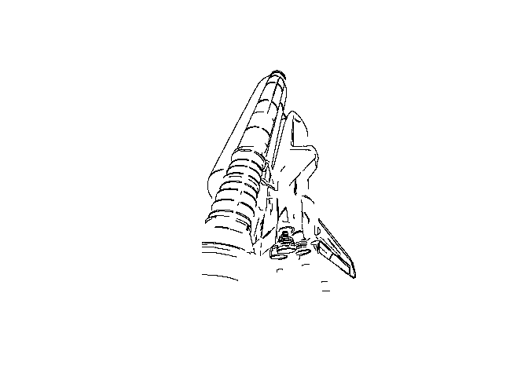
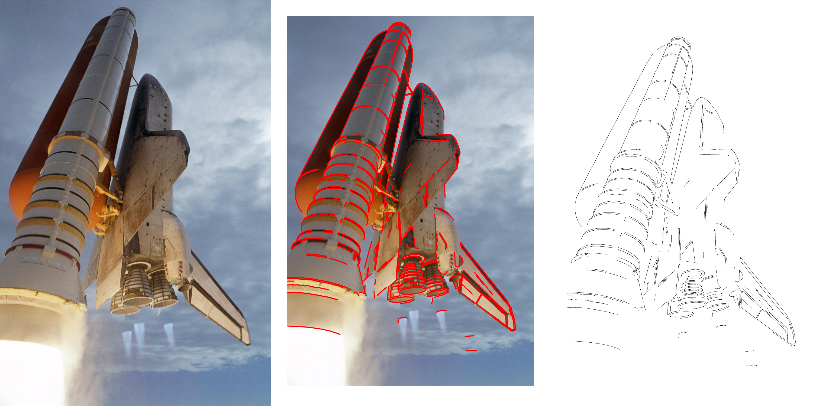

# Learning Countour Extraction in R


## Introduction

I am following RBlogger’s tutorial on finding contour lines (R-bloggers
/ BNOSAC. (2020, August 3). “Finding contour lines.”
https://www.r-bloggers.com/2020/08/finding-contour-lines/).

Contour extraction for archaeological data has recently gained traction,
especially for Lidar and other image-based approaches to site
identification. In Berganzo-Besga et al. (2026), the authors consider
best practices for the use of computer vision techniques for
archaeological applications. Throughout the body of the paper, the
authors offer up practical guidelines for the use of computer vision,
from data pre-processing and algorithm selection to training a model. As
they mention that many current applications of computer vision to
archaeological projects are unsuccessful, they hope that they practices
that they outline will improve the research outcomes of computer vision
for future use. As a main pre-processing step for computer vision,
contour extraction fits well with their guidelines.

## Tutorial

``` r
# Step 1: Install packages and add libraries to Quarto doc

library(magick)
```

    Linking to ImageMagick 6.9.13.29
    Enabled features: cairo, freetype, fftw, ghostscript, heic, lcms, pango, raw, rsvg, webp
    Disabled features: fontconfig, x11

``` r
library(image.ContourDetector)
library(sp)


# read in an image

img <- image_read("https://cdn.mos.cms.futurecdn.net/9sUwFGNJvviJks7jNQ7AWc-1200-80.jpg")


# change image to grey scale
mat <- image_data(img, channels = "gray")
```

In the above code block, I read in an image, as specified by the
tutorial, and then changed the image from a color image to a grey scale.
Grey scale is used because it encodes a pixel value into a single
numeric value. This makes it easier to work with. As a grey scale, the
image data is now in a matrix.

``` r
# Transform data type from a matrix to an integer array
mat <- as.integer(mat, transpose = TRUE)

# Drop redundancies
mat <- drop(mat)

# Add contour lines using contour detector
contourlines <- image_contour_detector(mat)
```

In this code chunk, we transform the data from a matrix (mat) to an
array. The `r.image-contour-detector` function in R only takes specific
data types, including arrays. The next line, contourlines, does the
heavy lifting of identifying contour lines for the image. In the next
code chunk, we plot the lines to see how it did.

``` r
plt <- plot(contourlines)
class(plt)
```

    [1] "SpatialLines"
    attr(,"package")
    [1] "sp"

<div id="fig-contour-lines">



Figure 1: Contour lines mapped from the original image, visualized on
their own

</div>

In <a href="#fig-contour-lines" class="quarto-xref">Figure 1</a>, we can
see the contour lines identified for the image we specified at the
beginning of the tutorial. The lines are extracted from the image, and
visualized on their own. This highlights the use of the
`r.image-contour-detector` function for image extraction.

``` r
#| label: fig-comparison
#| fig-cap: "Contour lines mapped from the original image, in comparison to the original image"

# See contours in comparison to the original image

plt <- image_graph(width = image_info(img)$width, 
                   height = image_info(img)$height)


plot(contourlines)
dev.off()
```

    png 
      2 

``` r
plt_combined <- image_graph(width = image_info(img)$width, 
                            height = image_info(img)$height)
plot(img)


plot(contourlines, 
     add = TRUE, 
     col = "red", 
     lwd = 5)
dev.off()
```

    png 
      2 

``` r
combi <- image_append(c(img, plt_combined, plt))
combi
```



``` r
image_write(combi, "example-contourlines.png", 
            format = "png")
```

The **?@fig-comparison** shows the original image, the contour lines as
they were mapped by the program, and the final output, the contours
extracted from the image. The above code chunk creates this sequence of
images from the original image, matrix, and contours created earlier in
the tutorial.

## My Data

``` r
attributes <- readxl::read_excel("data/Kokentau_Attributes.xlsx")

image <- image_read("data/out34/out34_sh01/out34_sh01_p01_yre20.jpg")
```

The data is stored in two ways. First, there is an excel sheet with the
different attributes recorded, which I have read into Rstudio as the
“attributes” variable. The file includes 10 columns and 75 rows. Columns
store information about the spatial location for each rock shelter and
granite outcrop, the number and type of figures recorded for for each
rock shelter, and where the images are stored for each outcrop and rock
shelter combination. Each row represents the outcrop and rock shelter
where the images were recorded.

Photos for each of the images recorded are also part of the dataset.
These are organized by outcrop number in zip files available in the data
repository. As an example, I downloaded and read in one image from one
such file. For this project, I would like to use the contour method
tried here to extract contours from each image, then use unsupervised
learning, perhaps k-means and HDBSCAN, to see if the cluster match what
was recorded for each row - can the computer help extract and classify
these motifs? We could then compare to the expert recordings.

## What Would Change?

As I am primarily interested in the images, I think that I would change
the way that the images are organized. I would remove them from the
zipped files organized by outcrop and instead place all images within
one file. I would then extract contours and attempt to cluster using
unsupervised methods. I would then compare the results with the excel
spreadsheet. I think that this would be an interesting test of
classification for a relatively subjective artifact interpretation, rock
art classification. One way that archaeologists could perform a similar
test with the same sort of data would be external validation of some
kind - if another expert analyzed the same data, would they come up with
the same classifications?

## References

Iban Berganzo-Besga, Hector A. Orengo, Felipe Lumbreras, Best practices
for the application of computer vision-based machine learning in
archaeology. Journal of Archaeological Science (2026) 191:106577.
https://doi.org/10.1016/j.jas.2026.106577

R-bloggers/BNOSAC. (2020, August 3). “Finding contour lines.”
https://www.r-bloggers.com/2020/08/finding-contour-lines/)
